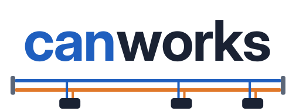

<h1><picture>
  <source media="(prefers-color-scheme: dark)" srcset="docs/images/logo-dark.svg">
  
</picture></h1>

An open CAN toolkit: configure, commission, diagnose, trace and simulate **CANopen**, **J1939** and plain **CAN** networks, from a PC on its own or with the bus run by an [OpenPLC Runtime v4](https://github.com/Autonomy-Logic/openplc-runtime) PLC, by a Modbus TCP bridge that any PLC or program can use, or by a CODESYS controller.

> **Experimental.** All code, tests and documentation in this repository were written by Claude (Anthropic's AI model), directed and tested by a person. Treat everything here as experimental: it has run on a test bench, not in production, and comes with no warranty (see [LICENSE](LICENSE)). Do not use it to control machinery where a fault could hurt people or damage equipment.

canworks has two halves:

- **Something that runs the bus**, picked per project as its [target](#targets): a runtime plugin for OpenPLC v4 that makes the PLC a CANopen master, slave or gateway, or a J1939 ECU, with plain CAN messages on any network, over SocketCAN; the same engine as a Modbus TCP bridge with no PLC; or CODESYS's own CANopen Manager, which canworks configures. The plugin and the bridge are built on [Lely CANopen](https://gitlab.com/lely_industries/lely-core) and the Linux kernel's J1939 stack, and the plugin installs next to an unmodified upstream runtime.
- **PC tools for Windows, macOS and Linux**: a configurator in the browser, a deploy tool, command-line diagnostics, a bus trace, device simulators and a local runtime in a container. They work through the PLC or straight through a USB CAN adapter on the PC, with no PLC at all.

## Targets

Every config has one target: the system that runs its networks. The configurator shows it on every Bus page and next to the project name, hides every setting the target does not use, and switches a config to another target in one undo step, removing or keeping what the new target does not use ([docs/configurator.md](docs/configurator.md#project-target)). A new config picks its target on the start page.

| | OpenPLC | Modbus bridge | CODESYS |
|---|---|---|---|
| **Who runs the bus** | The canworks plugin inside OpenPLC Runtime v4 | `canworks-bridge`, the same engine with no PLC | CODESYS's own CANopen Manager |
| **Where it runs** | Linux with SocketCAN | Linux with SocketCAN, as a service or a container | A CODESYS controller or display with CAN |
| **How the program sees the bus** | `%I`/`%Q` locations, plus the `canworks` function block library | Modbus TCP registers and coils, made from the `%I`/`%Q` locations | I/O channels, named after each PDO entry's variable name |
| **Networks** | CANopen master, slave and gateway, J1939, plain CAN | Same as OpenPLC | CANopen master |
| **How the config gets there** | The editor's **Build and upload**, or `canworks-deploy` | `canworks-deploy --bridge HOST` | **Build into CODESYS project…** or **Download for CODESYS** |
| **Marked in `canworks.json` by** | Nothing (the default) | A top-level `bridge` object | A top-level `codesys` object |

The PC tools work next to all three: the trace, commissioning and simulated devices. With CODESYS they reach the bus through a USB CAN adapter on the PC.

### OpenPLC

The plugin runs every network of the config inside the OpenPLC runtime and exchanges PDOs with the PLC image once per scan. The program reads and writes the bus on `%I`/`%Q` locations, and the blocks of the `canworks` library send SDOs, NMT commands, J1939 messages and raw frames when the program decides. Everything under [Features](#features) applies. Install it with the plugin lines in [Quick start](#quick-start).

### Modbus bridge

`canworks-bridge` runs the same CANopen, J1939 and raw CAN networks without OpenPLC and serves their values as Modbus TCP registers, so any PLC, SCADA or program with a Modbus client can use them ([docs/modbus-bridge.md](docs/modbus-bridge.md)). The config is a normal `canworks.json` with a `bridge` object that lists which addresses may write (`writers`); its `%I`/`%Q` locations become input and holding registers, discrete inputs and coils by one fixed rule. There is no PLC scan: a watchdog stops or holds the outputs when the client goes away, and status, control, live list and SDO request registers stand in for the function blocks. `canworks-deploy --export-modbus-map` writes the register map as CSV, JSON or IEC 61131-3 ST for the client side, and `canworks-deploy --bridge HOST` uploads a new config to a running bridge. It installs as a systemd service (`scripts/install-bridge.sh`) or runs from the `canworks-bridge` container image; [`examples/modbus-bridge`](examples/modbus-bridge/canworks.json) is a simulated example.

### CODESYS

canworks configures the bus, and CODESYS runs it: the CANopen master networks of a config go into a CODESYS project for a CODESYS controller or display with CAN, running CODESYS's own CANopen Manager ([docs/codesys.md](docs/codesys.md)). There are no PLC locations; each PDO entry has a variable name instead, and the config keeps the CODESYS project file, device, network numbers and CAN interfaces. **Build into CODESYS project…** runs CODESYS headless on this PC, and **Download for CODESYS** gives each node's DCF and a script that CODESYS runs on the open project, on its active device, under the device's own CAN interface when it has one. `canworks-deploy --export-codesys` and `--codesys-import` do the same from the command line. The nodes arrive with their PDOs, COB-IDs, timers, heartbeat and startup SDOs, the CANbus and manager with their settings, and every mapped I/O channel with the same variable name the OpenPLC editor uses; running it again replaces the nodes it manages. Slave, gateway, J1939 and plain CAN networks, the plugin's status locations, SDO variables and diagnostics channel stay with the other two targets; the import report lists the few settings left to set by hand in CODESYS, such as the nodes' identity checks.

## How it works

You describe the network in one JSON file (`canworks.json`, usually written by the configurator): the nodes, their EDS files, and which PDO entry goes to which PLC address (`%IX`, `%IB`, `%IW`, `%ID`, `%IL` and the `%Q` equivalents), or for CODESYS which variable name. For OpenPLC the file travels with the PLC program, either in the editor project's `canworks/` folder or through `canworks-deploy`. Numbers in it are plain decimal or `0x` hex (a leading zero such as `"012"` is refused, never read as octal), and a key given twice in one object is refused.

On OpenPLC, at every PLC start the plugin checks the file against the EDS files, generates the device configuration with Lely's `dcfgen`, boots and configures every node over SDO, and then exchanges PDOs with the PLC image once per scan. A node that is missing or drops off the bus never stops the PLC: its status bit goes FALSE and the master keeps trying to bring it back. A config with errors is logged and leaves the plugin inactive; the PLC still runs. The Modbus bridge does the same at its own start, and for CODESYS the same checks run on the PC before anything goes into the project.

## Quick start

**Try it without hardware.** [docs/tour.md](docs/tour.md) walks through [`examples/virtual-plant`](examples/virtual-plant/README.md): one editor project with four simulated networks that shows the features working together on a PC. You need a container engine, the PC tools and the OpenPLC Editor; no CAN hardware.

**Install the PC tools** with one line (installs [uv](https://docs.astral.sh/uv/), which brings its own Python, then the newest release; run it again to update; [docs/install-pc.md](docs/install-pc.md)):

```sh
curl -LsSf https://raw.githubusercontent.com/tonihoohoo/canworks/main/scripts/install-pc.sh | sh                                                  # macOS, Linux
powershell -ExecutionPolicy ByPass -c "irm https://raw.githubusercontent.com/tonihoohoo/canworks/main/scripts/install-pc.ps1 | iex"             # Windows
canworks-config                                                                    # opens the configurator
```

**Install the plugin on the PLC** (Linux with an OpenPLC v4 native or managed Docker install, [docs/install-stock.md](docs/install-stock.md)):

```sh
curl -LsSf https://raw.githubusercontent.com/tonihoohoo/canworks/main/scripts/install-runtime.sh | sudo bash                       # on the PLC: newest release, no git needed
curl -LsSf https://raw.githubusercontent.com/tonihoohoo/canworks/main/scripts/install-runtime.sh | bash -s -- --ssh pi@rpi.local   # or from a macOS/Linux PC over SSH
sudo systemctl restart openplc-runtime    # native installs: once, so the runtime loads the plugin
```

From Windows: `& ([scriptblock]::Create((irm https://raw.githubusercontent.com/tonihoohoo/canworks/main/scripts/install-runtime.ps1))) -Ssh pi@rpi.local`. Running the line again updates. Options go to `install-stock.sh` (`... | sudo bash -s -- --with-link`); `--with-link` reaches the PLC from other networks later ([docs/remote-access.md](docs/remote-access.md)). From a git checkout: `sudo scripts/install-stock.sh`.

**Other targets.** For the Modbus bridge, run `curl -LsSf https://raw.githubusercontent.com/tonihoohoo/canworks/main/scripts/install-bridge.sh | sudo bash` on the Linux device (add `-s -- --instance line1 --config ./line1` to set up and start a bridge), the same with `bash -s -- --ssh pi@rpi.local` from a macOS/Linux PC, `install-bridge.ps1 -Ssh pi@rpi.local` from Windows, or start the `canworks-bridge` container image ([docs/modbus-bridge.md](docs/modbus-bridge.md#install)). For CODESYS nothing is installed on the controller: pick CODESYS when you make the config, and build into the project from the Windows PC with CODESYS, or download the files for it from any PC ([docs/codesys.md](docs/codesys.md)).

**Configure and upload.** Build the network in `canworks-config` ([docs/configurator.md](docs/configurator.md)); it writes the editor project's `canworks/` folder, and the editor's own **Build and upload** carries it to the PLC. `canworks-deploy` does the same from a terminal ([docs/deploy.md](docs/deploy.md)).

## Features

### CANopen on the PLC

On OpenPLC, and on the Modbus bridge with registers in place of the program's blocks; CODESYS gets the master network settings it can take ([CODESYS](#codesys)). Every field is described in [docs/config.md](docs/config.md).

- **Networks and adapters:** up to 8 CAN networks from one PLC, each with its own adapter, master, bit rate, SYNC and nodes; a network that fails does not stop the others. Any SocketCAN interface works (CAN HAT, candleLight/gs_usb, PEAK, vcan), as do serial `slcan` adapters such as a CANable, driven directly without `slcand` and picked up again after a replug.
- **PDOs:** mapping from the config, or the device's own fixed or default mapping. Transmission type, inhibit time, event timer and SYNC start value default to the EDS's own values.
- **SYNC:** from a timer, from the PLC cycle (one SYNC every N scans), or none for event-driven PDOs only.
- **PDO links:** one node's TPDO feeds other nodes' RPDOs directly (CiA 301 producer/consumer), checked against both EDS files, optionally running on while the PLC is stopped; nodes can watch each other's heartbeat (`heartbeat_watch`). See [`examples/pdo-link`](examples/pdo-link/README.md).
- **Node bring-up:** startup SDO writes, identity check (0x1018), mandatory nodes, heartbeat or node guarding (a node without either is refused unless the config says so), configurable SDO timeouts, and an opt-in configuration check (0x1020) that skips an unchanged download. Saving to the device's non-volatile memory (0x1010) only happens when a node asks for it: a startup write to 0x1010 or 0x1011 is refused. PDOs on the SYNC, TIME, EMCY, SDO, heartbeat or LSS identifiers are refused too.
- **LSS:** devices without DIP switches get their node ID from their serial number at every start and after a replacement.
- **EDS checks:** every EDS goes through Lely's CiA 306 lint, and every PDO entry and SDO is checked for type and access before anything is sent.
- **Safe stops:** when the PLC stops, the nodes go PRE-OPERATIONAL (or STOPPED, or stay as they are: `on_plc_stop`); a scan that stops finishing cycles stops the outputs until it runs again (`scan_watchdog_ms`); a node that comes back gets the program's current outputs at once. A `stop_all_nodes` stop, `CO_NETWORK_STOP` and node holds last through link drops and node resets.
- **Status for the program:** a status bit and state byte per node, bus state and error counters, the last EMCY per node (every EMCY through `CO_RECV_EMCY`, and the device's own error history 0x1003 in the diagnostics), the EMCY COB-ID read from each device after its boot, and an optional receive timeout per input PDO.
- **From the program:** SDO variables, NMT commands, and the blocks of the [`canworks` function block library](docs/plc-library.md): SDO function blocks (`CO_SDO_READ`, `CO_SDO_WRITE`, ...) that read or write any object of any node when the program decides ([docs/plc-sdo.md](docs/plc-sdo.md)), NMT blocks (`CO_NMT`, `CO_NETWORK_START`, `CO_NETWORK_STOP`, `CO_GET_STATE`) that command any node, start and stop the network (autostart off with `master.start: false`; a node the program holds is never sent NMT START, also when it boots again) and read NMT states ([docs/plc-nmt.md](docs/plc-nmt.md)), and `CO_RECV_EMCY`, which hands the program every emergency message in order ([docs/plc-sdo.md](docs/plc-sdo.md)).
- **CiA 402 drives as PLCopen axes:** drive a node with the editor's motion blocks (`MC_Power`, `MC_MoveAbsolute`, `MC_Home`, ...) in profile position, velocity and homing mode, or in the cyclic synchronous modes (CSP, CSV, CST) ([docs/cia402.md](docs/cia402.md)).
- **Everything `dcfgen` can set**, plus a TIME producer that sends the runtime host's clock.
- **OpenPLC as a slave:** the PLC becomes a node on a network another master runs, with a generated EDS for that master's tool ([docs/slave.md](docs/slave.md)).
- **Gateway:** a slave network above master networks, with routes that copy values between them without the PLC program (held through upper master loss, gateway resets and field bus restarts), plus node status, EMCY forwarding and an SDO bridge ([docs/gateway.md](docs/gateway.md)).
- **Online diagnostics:** an opt-in channel for the PC tools, encrypted with TLS; the token never crosses the network, nothing a client does touches the PLC scan, and SDO writes, NMT commands and scans on a running network need an explicit force.
- **CiA 309-3 gateway:** opt-in standard CiA 309-3 text commands (SDO, NMT, PDO read, LSS, EMCY and boot-up notifications) for SCADA systems, test benches and scripts, on a loopback port of the PLC and from other machines through the encrypted diagnostics channel (`canworks-diag gateway`), with the same guards as the diagnostics channel ([docs/cia309-gateway.md](docs/cia309-gateway.md)).
- **Remote access:** the PLC shows up by name in the configurator on the local network, over a direct cable, USB-C or its Wi-Fi hotspot, and with the remote link from any other network, behind NAT or on a mobile connection, with no account, VPN or router port. A PC pairs once with the diagnostics token on the local network; internet access is a tick box ([docs/remote-access.md](docs/remote-access.md)).

### J1939 on the PLC

On OpenPLC and the Modbus bridge. A network with `"protocol": "j1939"` makes the PLC an ECU ([docs/j1939.md](docs/j1939.md)): its own NAME and address claim, received PGNs on `%I` locations with not-available (J1939-71 ranges) and timeout bits that drop when the bus is lost, sent PGNs from `%Q` locations periodically or on change, request handling, and messages up to 1785 bytes through the kernel's transport protocol. Trouble codes work both ways: other ECUs' DM1 codes and lamps reach `%I` locations and the `J1939_DM_READ` block, the PLC broadcasts its own codes switched by `%Q` bits, answers DM2, DM3 and DM11 from service tools, follows DM13, and clears other ECUs with `J1939_DM_CLEAR`. From the program, `J1939_SEND`, `J1939_RECEIVE` and `J1939_REQUEST` send, receive and request any PGN up to 1785 bytes from the claimed address, `J1939_ECU_INFO` and `J1939_FIND_ECU` give the claim state and find ECUs by NAME, and ST functions pack signals and NAMEs; the configurator copies the calls for a PGN. Signal scaling lives in a DBC file the tools use. J1939 and CANopen networks run side by side in one config, and a J1939 network has its own scan watchdog (`j1939.scan_watchdog_ms`).

### Raw CAN on the PLC

On OpenPLC and the Modbus bridge. Plain CAN messages run on any network, next to CANopen or J1939, or on a plain CAN network (`"protocol": "none"`, optionally listen-only) that carries nothing else ([docs/raw-can.md](docs/raw-can.md)). Received messages put DBC-style signals on `%I` locations with a timeout bit, counter and last frame; sent ones come from `%Q` locations periodically, on change or on a trigger bit. Multiplexed messages (simple and extended DBC multiplexing) work on raw and J1939 networks: received pages update their own signals with a valid bit each, and sent pages are picked by the program, sent all each period or in turn. Identifiers the protocol uses need an explicit override. Inputs go invalid at once when the adapter is gone, and program frames stop with the outputs (a plain CAN network has its own `raw.scan_watchdog_ms`). From the program, `CAN_SEND`, `CAN_SEND_CYCLIC`, `CAN_RECEIVE` and `CAN_BUS_INFO` and ST bit and byte helpers in the `canworks` library send and receive any frame when the program decides. [`examples/raw-can`](examples/raw-can/canworks.json) is a plain network with its DBC file and simulated devices.

### Simulation

- **Simulated devices** ([docs/simulator.md](docs/simulator.md)): any node, or a whole network, can be simulated from its EDS, so a project and its program run without the real devices or CAN hardware. Values can follow waveforms, formulas, recorded CSV data or a CiA 402 drive model; faults (EMCY, lost heartbeat, power loss, SDO aborts, wrong identity, ...) come on command or from timed scenarios that test the program's reaction.
- **Simulated machine:** an XYZ gantry with a gripper, a conveyor, sensors and a pallet on top of the simulated drives and I/O, shown in 3D in the configurator. [`examples/gantry-cell`](examples/gantry-cell/README.md) is a complete pick-and-place project.
- **Local runtime:** `canworks-sim-runtime` runs the stock OpenPLC Runtime with the plugin in a container on the PC, every network simulated, so the editor uploads to `localhost` and debugs there ([docs/local-runtime.md](docs/local-runtime.md)).

### PC tools

Five commands in one package, for Windows, macOS and Linux ([docs/install-pc.md](docs/install-pc.md)). They reach the bus through the runtime, or straight through a USB adapter on the PC with no PLC at all ([docs/pc-adapter.md](docs/pc-adapter.md)):

- **slcan** adapters (such as a CANable) on every system.
- **gs_usb / candleLight** adapters on Windows with nothing else to install (the tools bring the driver and libusb), and on macOS after `brew install libusb`.
- **SocketCAN** interfaces on Linux.

Every connection checks the bit rate first and refuses a wrong one, so a single device can be commissioned on the bench or as a guest on another master's bus, read-only until changes are allowed. Writes, NMT commands, scans and restores need `--force` while another master or a running node is on the bus.

| Command | What it does |
| --- | --- |
| `canworks-config` | The configurator, a local web page: build the network, commission devices, trace the bus, run simulations ([docs/configurator.md](docs/configurator.md)). |
| `canworks-deploy` | Adds the config to an editor build and uploads it, checks configs offline, creates editor projects, installs the `canworks` function block library, and exports DCF, DBC, HTML network documentation, CODESYS projects and Modbus register maps ([docs/deploy.md](docs/deploy.md)). |
| `canworks-diag` | The online functions from a terminal: parameter backup, compare and restore, LSS, raw frames, trace and replay, simulator control, `explain` for a frame bit by bit, the CiA 309-3 `gateway`, and `discover` and `link` for runtimes on other networks ([docs/diagnostics.md](docs/diagnostics.md)). |
| `canworks-sim-runtime` | The local simulator runtime in a container (Docker Engine, Podman or Colima; amd64 and arm64) ([docs/local-runtime.md](docs/local-runtime.md)). |
| `canworks-j1939-sim` | Plays one node of a J1939 DBC file on a SocketCAN interface or USB adapter, with address claim, cycle times, ramps and scenarios ([docs/j1939.md](docs/j1939.md#simulator)). |

On the runtime host, `canworks-sim` runs simulated CANopen devices and plain CAN devices on a SocketCAN interface for any master, with a `test` mode that writes a JUnit report ([docs/simulator.md](docs/simulator.md#canworks-sim)), and `canworks-link` is the remote link's service ([docs/remote-access.md](docs/remote-access.md)).

### Configurator

`canworks-config` opens in the browser with two workspaces, a connection bar that always shows what the page is connected to, and a status bar that lists running jobs with Cancel ([docs/configurator.md](docs/configurator.md)).

- **Configure** edits the config from a network tree, with problem badges on every entry and simulated nodes marked. Each node opens in tabs: General, PDOs, SDOs, Supervision, CiA 402, Simulation, Notes and Advanced. PDO entries are mapped to PLC addresses and checked against the editor project. Settings a device's EDS cannot back (EMCY without 0x1014, the heartbeat consumer without 0x1016, LSS, the configuration check) are off with the reason in grey, and turn amber with a Remove link only when the config still has them. Slave, gateway, J1939 and plain CAN networks are set up here too, with **Import DBC…** for CAN messages (the DBC file is kept in the config folder).
- **Connect…** in the connection bar is the one place to connect: to a runtime, the standalone simulator or a USB adapter, with recent connections one click away.
- **Commission** opens on a Nodes table of the live network. **Scan the bus** compares the bus with the config (Match, Missing, Not in config, Identity differs) and adds a found device to the config in one click. Each node has Status, Object dictionary, Parameters, Notes and Log tabs (states, EMCY, error history, SDO, NMT, LSS, parameter backup and restore), and simulated devices take faults and value overrides from their Status tab.
- **Commission a CANopen device** works on a USB adapter without any project. The Nodes table names every heard device without a scan (from 0x1008, a matching EDS or its profile) and matches devices against an EDS library folder picked with **Choose folder…**. **Change EDS…** swaps or clears a node's EDS, and a node without one gets the standard CiA 301/401/402 object dictionary. LSS and the PDO test run from here, and **Add to a config…** puts a device into a config.
- **Trace** records and decodes the bus ([docs/trace.md](docs/trace.md)). The By identifier view marks the bytes that change, a transmit list per network sends frames by hand, and **Decoding ▾** adds DBC files that decode their messages. PDOs decode without a config, from the layout set on the bus, read from the device or taken from the node's EDS (marked assumed); a read names any PDO it could not make usable and why. The frame inspector (closed with ✕ or Esc, layers that fold) and **Frame lab** (result beside its Examples, Build and Arbitration tabs) explain every bit of a frame ([docs/frame-inspector.md](docs/frame-inspector.md)). The trace opens in a window of its own to watch the bus while sending from the main window; the graph zooms with the mouse wheel and the lists and graph lanes resize.
- **Project target** OpenPLC, Modbus bridge or CODESYS on every Bus page: the page shows only what the target uses, and a switch removes or keeps the rest in one undo step ([docs/configurator.md](docs/configurator.md#project-target)).
- **Exports** from the **Export** menu: DCF files, a DBC file and an offline HTML document of the networks ([docs/network-docs.md](docs/network-docs.md)); a CODESYS project builds into CODESYS or downloads for it ([docs/codesys.md](docs/codesys.md)); a slave network's page has **Export EDS** for the other master's tool.
- **Device notes** explain objects: text, unit, scale, value meanings and bit names. CiA 301, 401 and 402 notes are built in, and a device's notes can replace or hide any built-in field. For anything else, each node's **Notes** tab shows your own notes first and is where you add (click an object's row), import and export them, also while commissioning a single device, where notes are written at once next to the EDS. Notes show in the object dictionary, the SDO lists and object pickers (unit and named values too), the HTML docs and the DBC export.
- **Lists:** a clicked or focused row is highlighted the same way in every list and table, and the object pickers and other list boxes have a resize bar that keeps its height ([docs/configurator.md](docs/configurator.md#the-page)).
- **Messages:** information, done, warning and error bars look the same everywhere and sit at the top of what they are about: the page, a view, a section or a dialog ([docs/configurator.md](docs/configurator.md#message-bars)).
- **Access:** states have their own icon shape as well as their colour, the same on every view and in both themes, and every task works from the keyboard alone ([docs/configurator.md](docs/configurator.md#colours-and-icons)).

### Device notes from a datasheet with Claude

The repository has a [Claude](https://claude.ai/code) skill, `canworks-datasheet-notes` ([`.claude/skills/canworks-datasheet-notes`](.claude/skills/canworks-datasheet-notes/SKILL.md)), that writes a device's notes file from its datasheet or manual (PDF, DOCX, ODT, HTML, spreadsheets or text) and its EDS. It shows every place where the datasheet and the EDS disagree in one table, each row set to follow the EDS until you change it, and checks its result with `canworks-deploy notes check`. The same `notes skeleton` (with `--all`, every object with its EDS default, limits and PDO mapping), `builtin` and `check` commands help when you write notes by hand ([docs/configurator.md](docs/configurator.md#notes-from-a-datasheet)). Notes stay on the PC and never reach a device.

## Requirements and limits

- **PLC side:** Linux with SocketCAN (`slcan` adapters need Linux 6.0 or later), OpenPLC Runtime v4 as a native install (`install.sh --native`) or upstream's managed Docker install ([docs/install-stock.md](docs/install-stock.md#docker-installs)). The runtime stays unmodified; `install-stock.sh` also installs an editor hook so the editor's **Build and upload** keeps the plugin on.
- **CANopen:** master and slave roles, one role per CAN interface; no flying master, MPDO or SRDO, and no program download into OpenPLC as a slave.
- **Raw CAN:** classic CAN only (no CAN FD), raw integer signals.
- **Remote link:** device on Linux aarch64 or x86_64, PC on Windows x64, macOS on Apple silicon or Linux (no iroh package for Intel Macs); for diagnostics, commissioning and uploads, not for control traffic ([docs/remote-access.md](docs/remote-access.md#what-the-remote-link-is-for-and-what-not)).
- **Modbus bridge:** Linux with SocketCAN, Modbus TCP server only (no RTU), one config per bridge process, and a CAN interface is used by either the bridge or the OpenPLC plugin, not both ([docs/modbus-bridge.md](docs/modbus-bridge.md#limits)).
- **CODESYS target:** CANopen master networks only (slave, J1939 and plain CAN networks stay with canworks), CODESYS V3.5 with CANopen support on Windows for the import, tested with V3.5 SP22 ([docs/codesys.md](docs/codesys.md#requirements-and-limits)).
- **J1939:** one ECU per interface, raw integer signals, diagnostic messages DM1, DM2, DM3, DM11, DM13 and DM22 only (no freeze frames or emissions DMs) ([docs/j1939.md](docs/j1939.md#limits)).

## Documentation

| Topic | Page |
| --- | --- |
| Guided tour without hardware | [tour.md](docs/tour.md) |
| Installing the plugin on the PLC | [install-stock.md](docs/install-stock.md) |
| Installing the PC tools | [install-pc.md](docs/install-pc.md) |
| The config file | [config.md](docs/config.md) |
| Configurator | [configurator.md](docs/configurator.md) |
| Device notes, by hand or from a datasheet with Claude | [configurator.md](docs/configurator.md#device-notes) |
| Deploy tool and exports | [deploy.md](docs/deploy.md), [network-docs.md](docs/network-docs.md) |
| Diagnostics and USB adapters on the PC | [diagnostics.md](docs/diagnostics.md), [pc-adapter.md](docs/pc-adapter.md) |
| CiA 309-3 gateway for SCADA, test benches and scripts | [cia309-gateway.md](docs/cia309-gateway.md) |
| Reaching the PLC from other networks, or with no network | [remote-access.md](docs/remote-access.md) |
| Bus trace and frame inspector | [trace.md](docs/trace.md), [frame-inspector.md](docs/frame-inspector.md) |
| Function blocks for the program (CANopen, CiA 402, CAN, J1939) | [plc-library.md](docs/plc-library.md), [plc-sdo.md](docs/plc-sdo.md), [plc-nmt.md](docs/plc-nmt.md), [cia402.md](docs/cia402.md) |
| Slave and gateway | [slave.md](docs/slave.md), [gateway.md](docs/gateway.md) |
| J1939 | [j1939.md](docs/j1939.md) |
| Raw CAN messages and frame blocks | [raw-can.md](docs/raw-can.md) |
| Modbus TCP bridge for any PLC or program | [modbus-bridge.md](docs/modbus-bridge.md) |
| CANopen networks in CODESYS | [codesys.md](docs/codesys.md) |
| Simulation and the local runtime | [simulator.md](docs/simulator.md), [local-runtime.md](docs/local-runtime.md) |
| CANopen standards: what canworks follows, where it departs, how it is checked | [standards.md](docs/standards.md) |
| Building, testing, CI and the repository layout | [development.md](docs/development.md) |

## Development

Security issues: see [SECURITY.md](SECURITY.md). [docs/development.md](docs/development.md) covers the development build, the test suites, CI and the repository layout. The configurator's page tests drive it in Chromium, and a separate browser workflow runs it against the real plugin on its simulated bus, with no CAN hardware or vcan. The behaviour is specified with [OpenSpec](https://github.com/Fission-AI/OpenSpec) in `openspec/specs/`, one folder per capability; new work starts as a change under `openspec/changes/` and is archived into the specs once merged.

### PC tools on Windows, macOS and Linux

`.github/workflows/pc-tools.yml` installs the PC tools with the one-line installer (`scripts/install-pc.sh`, `install-pc.ps1`; uv underneath) on Windows, macOS and Linux (x86_64 and ARM64) on version bumps on `main` (the release waits for it), on `deploy-v<version>` tags and on "Run workflow" (start it on a pull request's branch when a change needs those systems checked). On your own PC, from a checkout (bash; Git Bash on Windows):

```sh
uv build --wheel --out-dir dist tools/deploy && sh scripts/install-pc.sh --wheel dist/*.whl
uv run --no-project --python 3.12 --with jsonschema --with cantools python -m unittest discover -s tools/deploy/tests -t tools/deploy
uv run --no-project --python 3.12 python test/pc-tools/smoke.py "$(sed -n 's/^version = "\(.*\)"/\1/p' tools/deploy/pyproject.toml)"
```

A `deploy-v<version>` release publishes the tools as a wheel on GitHub and the local simulator runtime image `ghcr.io/tonihoohoo/canworks-sim-runtime:<version>` and the Modbus bridge image `ghcr.io/tonihoohoo/canworks-bridge:<version>` (`release-deploy.yml`). Its notes are `tools/deploy/release-notes.md` plus what each pull request since the previous release changed, and only the newest four releases are kept ([docs/install-pc.md](docs/install-pc.md#releases)).

## License

Apache License 2.0, see [LICENSE](LICENSE). Bundled third-party code keeps its own license: Lely's `dcf` package in `tools/deploy/canworks/_lely_dcf/` (Apache 2.0, with its NOTICE), uPlot in `tools/deploy/canworks/configurator/static/uplot/` (MIT) and three.js 0.169.0 in `tools/deploy/canworks/configurator/static/three/` (MIT). The ping-pong slave's EDS follows the [Lely CANopen C++ tutorial](https://opensource.lely.com/canopen/docs/cpp-tutorial/). Every other EDS file in this repository describes a made-up device written for the tests.
