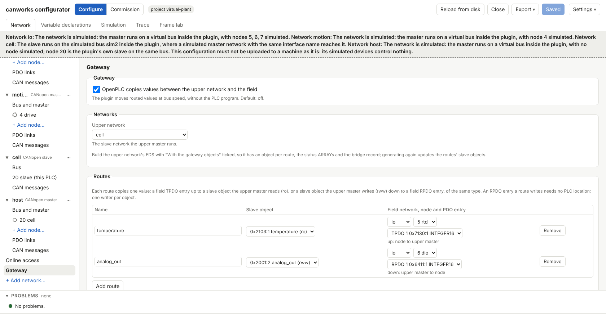
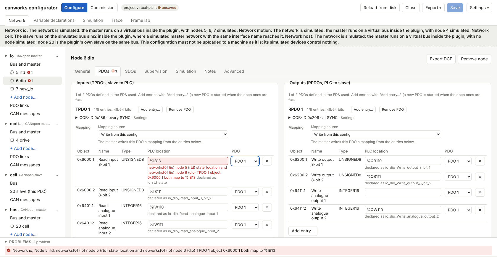

# Tour: every feature on a PC, without hardware

This tour takes you through [`examples/virtual-plant`](../examples/virtual-plant/README.md), one editor project with four simulated CANopen networks, on Windows, macOS or Linux. You need a container engine, the PC tools and OpenPLC Editor 4.3.2; no Linux device, no CAN adapter, no devices. Each chapter says what to do, what you see, and where the feature is described in full.

The plant: an I/O network `io` with a temperature module (node 5, RTD-8), a digital and analogue I/O module (node 6, DIO-16) and a second DIO-16 that gets its node ID over LSS (node 7); a network `motion` with a conveyor (node 4) the program runs at a set speed; and canworks as a gateway (slave node 20 on network `cell`) to a machine controller, which network `host` plays on the same simulated bus. The PLC program runs in the OpenPLC Runtime and reaches the networks through canworks-bridge over Modbus. All devices are made up. The [example's README](../examples/virtual-plant/README.md) lists every network, file and part of the program.

Times and cycle figures in a container say nothing about a real target.

## 1. Install

1. A container engine: on Windows, Ubuntu in WSL2 with Docker Engine or Podman; on macOS, Colima; on Linux, Docker Engine or Podman ([local-runtime.md](local-runtime.md#container-engine-once-per-pc)).
2. The PC tools with uv ([install-pc.md](install-pc.md)), then check: `canworks-deploy --version`.
3. The editor library with the SDO and NMT blocks the program uses ([plc-library.md](plc-library.md)); start the editor once first, then:

   ```sh
   canworks-deploy library --install
   ```

4. The local runtime:

   ```sh
   canworks-local-runtime start
   ```

   It prints the address `localhost:8443` and the user for the editor; `canworks-local-runtime status --show-password` prints the password.
5. The example: download the repository (**Code → Download ZIP** on GitHub, or `git clone`) and copy `examples/virtual-plant` to where you keep editor projects.

The diagnostics token of the example is `virtual-plant-demo`. Set it for the command line in this terminal:

```sh
export CANWORKS_TOKEN=virtual-plant-demo        # PowerShell: $env:CANWORKS_TOKEN = "virtual-plant-demo"
```

## 2. The configurator and its checks

```sh
canworks-config path/to/virtual-plant
```

The configurator runs in the background and stops when its tab is closed (**Quit** in the header asks first); run the same line again to get a tab back ([configurator.md](configurator.md#start)). The page opens in **Configure** on the project, with its four networks in the network tree on the left: `io`, `motion`, `cell`, `host` ([configurator.md](configurator.md#network-tree)). Click a node in the tree: it opens in tabs (**General**, **PDOs**, **SDOs**, **Supervision**, ...), and the tab you pick stays as you go from node to node ([configurator.md](configurator.md#node-tabs)). Look around:

- `io` → node `dio`: on **PDOs** the PDOs it maps from the config (**Bits…** on an entry gives single bits a BOOL variable and a name of their own, [configurator.md](configurator.md#bit-channels)), on **SDOs** the startup SDO 0x2000 and the SDO variables `operating_hours` and `filter_time`, on **Supervision** the NMT command byte, and on **Advanced** the configuration check with store sub-index 1 and the TIME COB-ID with the consumer bit. Node `new_io` → **Advanced** has a serial number and **Assign node ID by serial number**. Node `rtd` is mandatory (**Advanced**), and on **PDOs** its TPDO 1 has a receive timeout of 200 ms with a status bit (the TPDO's **Settings**).
- `motion` → node `conveyor`: on **PDOs** the speed set-point it receives and the actual speed and belt position it sends; `motion` → **Bus and master**: SYNC every 10 ms.
- `cell` → **Bus**: the slave network's page (Bus and slave device) with the objects the program reads and writes ([slave.md](slave.md)).
- **Gateway**, the tree entry after the networks: its two routes, the field status, EMCY forwarding, the SDO bridge and **When the upper master is lost**: **Zero** ([gateway.md](gateway.md)).
- `host` → node `cell` (node 20) is the cell itself, not simulated: canworks' own slave answers.
- **Project target** at the top of each Bus page says who runs the config: **OpenPLC** here, through the bridge. Pick **CODESYS** and the dialog lists what CODESYS does not use (the slave and J1939 networks, the status locations, the simulated devices); press Cancel to keep the project as it is ([configurator.md](configurator.md#project-target)).



**A deliberate mistake:** on `io` → `dio` → **PDOs**, change the address of TPDO 1's first entry from `%IB20` to `%IB63`. **Problems** at the bottom opens at once and reports that `%IB63` is already node `rtd`'s state byte; the tree entries of `rtd` and `dio` and the **PDOs** tab show `1✕`, the field turns red and **Save** is disabled, its tooltip counting the errors. Click the problem: it leads to the field. Change it back, or press Ctrl+Z (Cmd+Z on a Mac) ([configurator.md](configurator.md#checks-and-saving)). The deploy tool runs the same checks ([deploy.md](deploy.md)).



## 3. Exports

From the configurator's **Export** menu in the header (**Network files**: **All DCFs**, **DBC**, **Documentation**; **For the program**: the register map files and **ST for another PLC**) and `cell` → **Bus** → **Export EDS**, or from a terminal in the project folder:

```sh
canworks-deploy --export-html plant.html --config canworks/canworks.json      # network documentation
canworks-deploy --export-dcf dcf --config canworks/canworks.json              # a DCF per node, a folder per network
canworks-deploy --export-dbc io.dbc --network io --config canworks/canworks.json
canworks-deploy slave-eds canworks/cell_eds.json -o cell.eds --gateway canworks/canworks.json
```

`plant.html` is one offline document: the topology, COB-ID map and bus load of each network, every node's PDO layouts and boot SDO writes, and the PLC I/O cross-reference with the program's variable names ([network-docs.md](network-docs.md)). The DCF files are what a master configures on each node ([deploy.md](deploy.md#export-the-nodes-as-dcf-files)); the DBC file opens in SavvyCAN or Wireshark ([deploy.md](deploy.md#export-the-network-as-a-dbc-file)). `slave-eds` writes the EDS the machine controller's tool would import for node 20, with a slave object per route and the gateway's status and SDO bridge objects ([slave.md](slave.md), [gateway.md](gateway.md)); it is the same as the project's `canworks/cell.eds`.

## 4. Upload and the debugger

Put the config on the local bridge, from a terminal in the project folder:

```sh
canworks-deploy --config canworks/canworks.json --bridge local
```

In the editor: open the project folder, set the device to OpenPLC Runtime v4 at `localhost:8443` with the printed user and the password from `canworks-local-runtime status --show-password`, and **Build and Upload** ([local-runtime.md](local-runtime.md#use-it)). The project's remote device `canworks` reads and writes the bridge, and `canworks_in` and `canworks_out` copy its registers into the `canworks` variable list around `main`.

`canworks-local-runtime logs` shows the bridge's start: each network's simulated bus, `node 7 (new_io): LSS assigned node ID 7 (previous: none)`, then every node OPERATIONAL, `host: node 20 (cell) is operational` and `cell: gateway: the upper master started this node; routes run`.

Start the debugger on `main` and the `canworks` list. You see:

- `canworks.io_rtd_AI0_Input_PV` moving between 200 and 260 (20.0-26.0 °C, a 30 s sine) and `temp_c`; `alarm` comes on above 25.0 °C;
- `pattern` walking along output byte 2 and `loop_ok` TRUE;
- `canworks.host_cell_temperature`, the RTD value as the host receives it through the gateway, and `canworks.io_dio_Read_analogue_input_1`, the same value after the host sent it back down to the DIO-16;
- `canworks.motion_conveyor_speed_actual` following the set-point 1000 while the host runs the line, and `canworks.motion_conveyor_belt_position` counting up;
- `rtd_product`, `conveyor_product`, read by the SDO function blocks; `canworks.io_dio_operating_hours`, read by an SDO variable every second.

The configurator's **Devices** page puts the config on the bridge too ([devices.md](devices.md)); a changed config goes the same way, and the program needs a new upload only when its locations moved ([deploy.md](deploy.md)).

## 5. Online diagnostics

In the configurator, switch to **Commission** at the top and press **Connect…** in the connection bar, the one place to connect: press **Local runtime**, then **Connect**, and enter the token `virtual-plant-demo` when the page asks for it ([configurator.md](configurator.md#online-access)). The connection bar under the tabs then shows the runtime and **Disconnect**. Pick a network on the tree (the bar's network picker follows, and the other way round) for its Nodes table, and click a node for its tabs ([configurator.md](configurator.md#online-view)):

- `io`: master and bus state, nodes 5, 6, 7 OPERATIONAL (the filled circle on the tree and in the Nodes table; **Settings** → **Colours and icons** lists every icon). Node 5 → **Status**: the TPDO 1 receive timeout, and every 60 s an EMCY 0x5000 (the simulation's wire-break timeline) in its **Emergency history**; a small flag marks node 5 on the tree until you open its **Status**. Node 6 → **Status**: its SDO variables.
- `cell`: the bridge's own device, node 20: its state, SYNC count, PDOs with the gateway routes, and the gateway row: 2 routes, upper master present.
- Node 6 → **Status** → **NMT** → **Reset node**, and confirm: the node boots again, and because its configuration stamp (0x1020) still matches, the master starts it without downloading the configuration again ([config.md](config.md#configuration-check)). The **Log** at the bottom records the reset and the boot; node 6's **Log** tab shows its own entries.

From a terminal:

```sh
canworks-diag --runtime local status
canworks-diag --runtime local sdo-read 6 0x1018 2 --network io
canworks-diag --runtime local emcy 5 --network io
```

[diagnostics.md](diagnostics.md) lists every command.

## 6. Device parameters

**Commission** → `io` → node 6 → **Object dictionary**: **Read all**, then the **Changed from default** filter shows what the config wrote (the PDO mapping, 0x2000, 0x1012). On node 5 → **Object dictionary**, **Edit** 0x6110 sub 3 (channel 2's filter) to 30 and pick **Keep in configuration**: it becomes a startup SDO of node 5 and the header shows **● unsaved**; **Save**, then put the config on the bridge as in chapter 4. Node 6 → **Parameters**: **Back up** downloads a DCF of the node; **Compare** it against the configuration; **Store on device…** writes "save" to 0x1010, and the simulated device keeps the values over a power cycle ([configurator.md](configurator.md#online-view)).

`canworks-diag --runtime local backup 6 --network io -o dio.dcf` does the backup from a terminal.

## 7. Simulation and faults

**Commission** → the **Simulation** tab, network `io` in the connection bar's picker, **Live values**: click a device for its **Values** and **Faults** ([configurator.md](configurator.md#simulation-view), [simulator.md](simulator.md)):

- node 5 → **Values**: the value sources of the four channels (sine, random walk, ramp, a formula on channel 0); **Override** channel 0 with 300: `alarm` comes on, DIO-16 output 0.0 follows, and on `host` the cell's `host_cell_alarm` with EMCY 0x4210;
- node 6 → **Faults** → **Heartbeat stop**. Node 6's status bit goes FALSE, the program's `fault` switches `new_io` output 0.0 on, and the gateway status on `cell` shows node 6 missing, so the host's output 0.1 comes on too. **Clear all** and the master boots node 6 again;
- node 5 → **Faults** → **TPDO stop…** 1: after 200 ms `io_rtd_tpdo1_timeout` is TRUE while node 5 stays OPERATIONAL;
- **Simulation file** shows the `io` section; switch the network picker to `motion` for the conveyor's section. Both are in the one `canworks/simulation.json` (version 2, a section per network).

The same from a terminal: `canworks-diag --runtime local sim fault 6 heartbeat-stop --network io`, `sim clear 6 all --network io`.

## 8. LSS

`new_io` (node 7) got its node ID at start from the master, by its serial number 7007 ([config.md](config.md#lss)). A second module, `spare_io` (serial 7099), is on the bus without a node ID and is not in the config: **Commission** → `io` → **Unconfigured devices (LSS)** → **Find a device without node ID** finds it; **Set node ID…** gives it, say, 8, and the Nodes table then lists node 8 as **Not in config** with **Add to config**. **Scan the bus** compares the whole network with the config. It asks first, because the PLC program runs nodes 5, 6 and 7 and the scan sends SDO requests to every node ID: pick **Scan anyway**. rtd, dio and new_io then read **Match**. A simulated node's **Status** tab has a **Simulated device** panel with the faults of chapter 7, so a quick fault does not need the Simulation tab: **Heartbeat stop** there turns the node's status bit FALSE in the table, marks it on the tree and puts the event in its **Log** tab; **Clear** brings it back.

```sh
canworks-diag --runtime local lss-find --network io
```

## 9. The conveyor

Network `motion`: the program sets the conveyor's speed to 1000 while the host runs the line, and 0 otherwise; the simulated conveyor's actual speed follows the set-point with a lag, and its belt position adds up the speed. **Commission** → `motion` → node 4 → **Object dictionary**: tick **Watch** on 0x2000 sub 1 (speed set-point), 0x2100 sub 1 (actual speed) and 0x2101 sub 1 (belt position). **Simulation**, `motion` → **Live values** → node 4 → **Values**: **Override** the actual speed with 0 and the belt stops counting. The host stops the line when it is lost (next chapter), and the conveyor then stops.

## 10. Slave and gateway

The cell (node 20) is canworks as a slave: the host writes `line_run` and `temp_limit`, the program writes `alarm`, `belt_position` and `cycle_count` ([slave.md](slave.md)). The gateway copies RTD channel 0 up and the host's `analog_out` down to DIO-16 analogue output 1 in the bridge, without the program ([gateway.md](gateway.md)).

- **Commission** → `host` → node 20 → **Object dictionary**: 0x5E00 sub 5, 6, 7 are the NMT states of the field nodes on `io`, 0x5E10 sub 1 their operational bits; 0x5E01/0x5E11 those of `motion`.
- The SDO bridge: write the network (0), node (5), index 0x1018, sub-index 2, then command 1 to 0x5F00 from **Commission** → `host` → node 20 → **Status** (its SDO panel), and read the product code of node 5 back in sub-index 5 ([gateway.md](gateway.md#sdo-bridge)).
- Upper master lost: **Commission** → `host` → node 20 → **Status** → **NMT** → **Stop**, and confirm. The cell leaves OPERATIONAL, `cell_line_run` drops (inputs on loss: zero), the conveyor stops, and the gateway sets DIO-16 analogue output 1 to 0. **Start** brings it back.

## 11. Trace with a trigger

The **Trace** tab under the header, network `io` in its picker ([trace.md](trace.md)): **Start**. **By identifier** shows one row per COB-ID with its cycle time (SYNC every 20 ms, TIME every second) and tints the bytes that change, and **Chronological** scrolls the frames decoded with the config's names. **Graph**: add node 5's channel 0 and node 6's analogue input 1 in one lane and see the second follow the first through the gateway and the host. **Trigger**: EMCY from node 5, single mode, 2 s before and after; the wire-break timeline fires it within a minute, and the hit is listed and marked in the graph. **Save** ▾ → **Download** the window as pcapng for Wireshark, or candump or CSV.

**Decoding** ▾ → **Add DBC…** with the `io.dbc` of chapter 3: the file is listed with how many of its messages are used, and its notes say why the others are not: the config's own PDOs decode those identifiers first. A DBC file is for identifiers the config does not describe, such as another master's frames; without a config, as in Commission a device, it decodes them all ([trace.md](trace.md)).

## 12. Frame inspector

Select any frame of the trace: the inspector beside the list explains it layer by layer, from the decoded meaning down to every bit on the wire. With the trace still recording, reset node 6 again: **Commission** → `io` → node 6 → **Status** → **NMT** → **Reset node** (the recording goes on while you are in the other workspace). Back on **Trace**, **Sequences** shows node 6's boot as a story, and the SDO conversations of the SDO variables ([frame-inspector.md](frame-inspector.md)). **Frame lab** builds frames by hand without a bus: pick an example, build one or run two against each other, and the result shows beside the tools. The **✕** of the Trace inspector closes it when you want the whole width for the list; clicking a frame opens it again.

## 13. Sending raw frames

**Trace** → **Transmit list**, under the trace (needs **Allow changes**, which the example has): **Add frame**, identifier `000`, data `81 06` (NMT reset node 6), **Send**. The runtime asks for force, because 0x000 is an identifier the network uses; confirm, and node 6 boots again in the trace. A row with a period, say `6FF` every 100 ms, is a cyclic job that shows as Tx in the trace until you stop it; the list is still there next time ([diagnostics.md](diagnostics.md#sending-frames-by-hand)).

## 14. Scenario tests

`canworks/simulation.json` has four scenarios marked as tests: `alarm`, `gateway-route` and `dio-lost` on `io`, `conveyor-runs` on `motion`. They change the simulated devices and check the program's reaction on the bus:

```sh
canworks-diag --runtime local sim test --network io --scenario alarm --scenario gateway-route --scenario dio-lost --junit io.xml
canworks-diag --runtime local sim test --network motion --scenario conveyor-runs
```

Each prints PASS or FAIL with the step and value that failed, and `--junit` writes a report for a CI system ([diagnostics.md](diagnostics.md#simulated-devices-sim)). Change the alarm limit in the program to 30.0 °C, upload, and `alarm` fails. CI runs the same tests on every change to the bridge or the example ([`test/virtual-example/run.sh`](../test/virtual-example/run.sh)).

When you are done: `canworks-local-runtime stop`, or `remove --data` to delete it.

## What needs hardware

Some features cannot be shown on a simulated bus:

- **The bit rate check** of a USB adapter connection needs a real bus: a simulated bus has no bit rate ([pc-adapter.md](pc-adapter.md#the-check-on-connect)).
- **slcan adapters** (CANable and similar) and unplugging one while the bus runs need the adapter ([config.md](config.md)).
- **Bus error states** (error passive, bus-off and recovery) need a real controller and a fault on the wire.
- **Commissioning straight from the PC** through a USB adapter, with no runtime, needs the adapter and a device ([pc-adapter.md](pc-adapter.md)); through **Adapter on another machine** in the connect panel, a Linux machine with the adapter that runs `canworks-diag adapter-serve` ([pc-adapter.md](pc-adapter.md#an-adapter-on-another-machine)).
- **J1939 networks** need the Linux kernel's J1939 support and do not run on the simulated bus; try them on a Linux device's bridge with `canworks-j1939-sim` and [`examples/j1939`](../examples/j1939) ([j1939.md](j1939.md)).
- **Real-time timing**: SYNC jitter, PDO latency and the Modbus poll in a container say nothing about a real target.
- **The install on a Linux device** (the runtime and the bridge from the configurator's **Devices** page or `install-bridge.sh`) and its CAN interface ([devices.md](devices.md), [modbus-bridge.md](modbus-bridge.md#install)).
