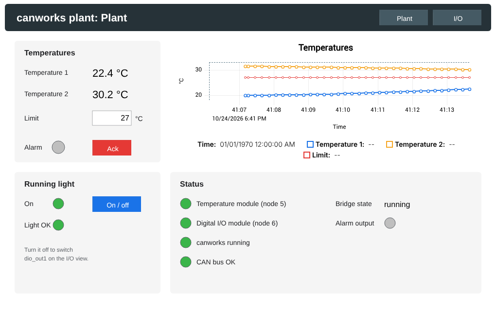

# FUXA example: control in Node-RED, HMI in FUXA

[FUXA](https://github.com/frangoteam/FUXA) is a web HMI with Node-RED built in. In this example, FUXA's Node-RED does the control on the canworks Node-RED nodes ([docs/node-red.md](../../docs/node-red.md)), and the screens are drawn in FUXA. The plant is the simulated one of the [Node-RED dashboard example](../node-red-dashboard/README.md):
- a temperature module (node 5), whose first two channels follow a sine (20.0-26.0 °C) and a ramp;
- a 16-bit digital I/O module (node 6), whose outputs loop back to its inputs.

Both nodes are simulated inside canworks-bridge, so no CAN interface is needed.



```
FUXA views ── tags of the FUXA Server device ── FUXA's Node-RED (plant logic)
                                                   │ node-red-canworks, one Modbus TCP connection
                                                   v
                                     canworks-bridge 127.0.0.1:1502 ── simulated plant
```

Node-RED is the bridge's only client. FUXA has no device of its own: it shows and writes its own tags, and the flow moves the values between those tags and the plant.

## Run it with Docker

You need Docker with Compose. Use Docker Desktop on macOS and Windows. With Colima on a Mac, you also need the `docker-compose` plugin, for example from Homebrew. In this folder:

```sh
docker compose up
```

Then open the HMI at <http://localhost:1881> and the flow at <http://localhost:1881/nodered/>. Only the images come from the internet. FUXA's Node-RED is in its image, and the canworks package has no dependencies.

`docker compose up` starts:

- **setup**, from the canworks-bridge image. It copies the plant's files for the bridge and writes the Node-RED package `node-red-canworks-<version>.tgz` and the flow of [canworks.json](canworks.json), then exits. Both come from the bridge image, so the package, the flow and the bridge always have the same version.
- **bridge**: canworks-bridge with the simulated plant. It serves Modbus TCP on `127.0.0.1:1502`, inside the pair only.
- **fuxa**: `frangoteam/fuxa:1.3.5` in the bridge's network. [start.sh](start.sh) turns on FUXA's Node-RED, which is off by default (`nodeRedEnabled` in `_appdata/mysettings.json`). It installs the canworks package into Node-RED's user folder `_appdata/node-red`, and it writes the exported flow plus [plant.json](plant.json) once. After FUXA starts, it loads [fuxa/project.json](fuxa/project.json) once.

| Setting | How |
| --- | --- |
| canworks version | `CANWORKS_VERSION=0.137.1 docker compose up` (default `latest`). A new version reinstalls the package and keeps your flow and views. |
| Stop | `docker compose down`. Your flow and FUXA project stay in the `fuxa-appdata` volume. |
| Start over, for example after changing `canworks.json` | `docker compose down -v`, then `docker compose up`. |

The OpenPLC + FUXA example also uses port 1881, so stop one example before you start the other.

## The HMI

- **Plant**:
  - both temperatures with a trend;
  - the **Limit**, the alarm lamp and **Ack**;
  - the running light (**On / off** and its check);
  - the status of both nodes, of canworks and of the CAN bus, and the bridge state.
- **I/O**: the 16 inputs and 16 outputs as lamps, and the manual output bits. Click a manual bit to switch it. Bits 1-7 of `dio_out0` follow it at once. `dio_out1` follows it while the running light is off, and an output you switch comes back on its input within a poll or two.

The values are tags of FUXA's own server device ("FUXA Server" under Devices in FUXA's editor). Each tag's id is its name, the same names as in the OpenPLC + FUXA example:

| Tags | Written by |
| --- | --- |
| `temp1`, `temp2` (°C), `rtd_ok`, `dio_ok`, `canworks_ok`, `bus_ok`, `alarm`, `light_ok`, `dio_in0`, `dio_in1`, `dio_out0`, `dio_out1`, `bridge_state` | Node-RED |
| `limit` (25 at start), `run` (on at start), `ack`, `manual_out0`, `manual_out1` | the operator in FUXA; Node-RED sets `ack` back to off |

Change the views or add your own in FUXA's editor at <http://localhost:1881/editor>, binding them to these tags.

## The flow

The tab **Plant logic** in Node-RED has:
- **canworks in** → **plant logic** → **canworks out**, plus a 500 ms tick. The plant logic node is the same as in the dashboard example (`PLANT_LOGIC` of the other examples):
  - The alarm comes on when temperature 1 goes over the limit. It stays on until **Ack** is pressed while the temperature is at or below the limit, and it sets bit 0 of `dio_out0`.
  - While the running light is on, one bit walks along `dio_out1` every 500 ms. The light counts as OK while `dio_in1` matches what was written.
- **to FUXA tags**, a function that writes the plant state to the tags through `global.get("fuxa").setTag(id, value)`. This is FUXA's runtime interface, the one its own nodes use. A tag is written when it holds another value, so the tags are filled again after FUXA reloads its project.
- FUXA's **get-tag-change** nodes, which bring `limit`, `run`, `ack` and the manual bytes back to the logic, and **get-tag** nodes that read them once at deploy.

## Good to know

- **Control and HMI run in one process.** Restarting FUXA, or deploying the flow, restarts the logic. The bridge's watchdog takes the outputs to their safe values meanwhile ([docs/modbus-bridge.md](../../docs/modbus-bridge.md)). For hard timing, put the control in a PLC.
- **The operator values start over.** `limit`, `run` and the manual bytes return to their start values when FUXA restarts or when its project is saved in the editor. The logic follows them. Change a start value in the tag's settings in FUXA's editor.
- **Security.** As in FUXA's defaults, FUXA's login is off and the Node-RED editor is open. The compose file publishes only on `127.0.0.1`. Before opening the HMI to a network, turn on FUXA's security (`secureEnabled`). Node-RED then wants a FUXA login or API key (`nodeRedAuthMode: secure`, the default).

## Run it without Docker

You need canworks-bridge installed on a Linux device ([docs/modbus-bridge.md](../../docs/modbus-bridge.md#install)) and FUXA anywhere on the network.

1. Start the bridge with this folder's config. Either copy `canworks.json`, `simulation.json` and the two EDS files to `/etc/canworks-bridge/plant/` and run `sudo systemctl start canworks-bridge@plant`, or run `canworks-bridge --config canworks.json` in a copy of the folder. If FUXA runs on another machine, change `bridge.listen` to `0.0.0.0:1502` and `writers` to FUXA's address.
2. Turn on FUXA's Node-RED: set `"nodeRedEnabled": true` in FUXA's `_appdata/mysettings.json` and restart FUXA.
3. Run `canworks-deploy --export-nodered-package .`, then install the `.tgz` in FUXA's Node-RED (Manage palette > Install > Upload).
4. Run `canworks-deploy --config canworks.json --export-nodered plant_node-red.json`. Add `--nodered-host <device>` when FUXA runs on another machine. In Node-RED, import `plant_node-red.json` and then `plant.json` (Menu > Import). The flow's nodes use the bridge node **canworks plant** of that export, so keep the file name.
5. In FUXA's editor, open `fuxa/project.json` (Project > Open).
6. Deploy the flow and open FUXA.
