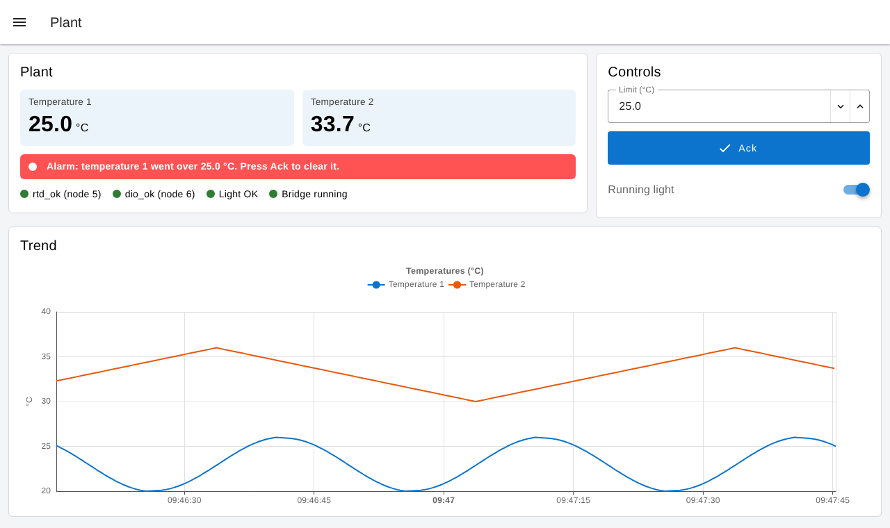

# Node-RED dashboard example

A [Node-RED Dashboard 2.0](https://dashboard.flowfuse.com) on the canworks Node-RED nodes ([docs/node-red.md](../../docs/node-red.md)), running against the simulated plant of the [Modbus bridge example](../modbus-bridge/canworks.json): a temperature module (node 5) whose first two channels follow a sine (20.0-26.0 °C) and a ramp, and a 16-bit digital I/O module (node 6) whose outputs loop back to its inputs. Both nodes are simulated inside canworks-bridge, so no CAN interface is needed. The CODESYS and truST examples use the same plant, tags and logic.



## Run it with Docker

You need Docker with Compose (Docker Desktop on macOS and Windows; with Colima on a Mac also the `docker-compose` plugin, for example from Homebrew) and internet on the first start. In this folder:

```sh
docker compose up
```

Then open the dashboard at <http://localhost:1880/dashboard> and the flow editor at <http://localhost:1880>. The first start takes a minute or two while Node-RED installs its packages.

`docker compose up` starts:

- **setup**, from the canworks-bridge image: copies the plant's files for the bridge and writes the Node-RED package `node-red-canworks-<version>.tgz` and the flow of [canworks.json](canworks.json), then exits. Both come from the bridge image itself, so the package, the flow and the bridge always have the same version.
- **bridge**: canworks-bridge with the simulated plant, serving Modbus TCP on `127.0.0.1:1502` inside the pair only.
- **node-red**: `nodered/node-red:4.1` in the bridge's network, so it reaches the bridge at `127.0.0.1:1502` on every system. [start.sh](start.sh) installs the canworks package and Node-RED Dashboard 2.0 into the `/data` volume, loads the exported flow plus [dashboard.json](dashboard.json) once, and starts Node-RED.

| Setting | How |
| --- | --- |
| canworks version | `CANWORKS_VERSION=0.134.0 docker compose up` (default `latest`). A new version reinstalls the package and keeps your flow. |
| Stop | `docker compose down` (your flow stays in the `node-red-data` volume). |
| Start over, for example after changing `canworks.json` | `docker compose down -v`, then `docker compose up`. Without it, Node-RED keeps the old flow and its nodes show **map mismatch: export the flow again** once the map moved. |

## The dashboard

- **Plant**: both temperatures with a trend, a status dot per node (`rtd_ok`, `dio_ok`), the running light's check, the bridge state, the **Limit**, the alarm and **Ack**.
- **I/O**: the 16 outputs (`dio_out0`, `dio_out1`) as switches and the 16 inputs (`dio_in0`, `dio_in1`) as lamps. An output you switch comes back on its input within a poll or two.
- **Service**: NMT **Start**, **Stop** and **Reset node** for node 5 or 6 (the **nmt** node), **Read device name** (0x1008 through the **sdo** node) and a table of received EMCY messages (the **emcy** node).

The plant logic is the **plant logic** function node, the same as `PLANT_LOGIC` in the other examples:

- The alarm comes on when temperature 1 goes over the limit (25.0 °C at start) and stays on until **Ack** is pressed while the temperature is at or below the limit. It sets bit 0 of `dio_out0`.
- While **Running light** is on, one bit walks along `dio_out1` every 500 ms, and the light counts as OK while `dio_in1` matches what was written. Turn it off to switch `dio_out1` by hand.

The values' names come from the PDO entries' `name`s in [canworks.json](canworks.json): `rtd.temp1` in Node-RED is `rtd_temp1` in the PLC examples.

## Run it without Docker

With canworks-bridge installed on a Linux machine ([docs/modbus-bridge.md](../../docs/modbus-bridge.md#install)) and Node-RED 3 or 4 on the same machine:

1. Start the bridge with this folder's config: copy `canworks.json`, `simulation.json` and the two EDS files to `/etc/canworks-bridge/plant/` and `sudo systemctl start canworks-bridge@plant`, or run `canworks-bridge --config canworks.json` in a copy of the folder.
2. `canworks-deploy --export-nodered-package .` and install the `.tgz` in Node-RED (Manage palette > Install > upload), and install `@flowfuse/node-red-dashboard` from the palette.
3. `canworks-deploy --config canworks.json --export-nodered plant_node-red.json`, then in Node-RED import `plant_node-red.json` and then `dashboard.json` (Menu > Import). The dashboard's nodes use the bridge node **canworks plant** of that export, so keep the file name.
4. Deploy and open `http://<machine>:1880/dashboard`.
