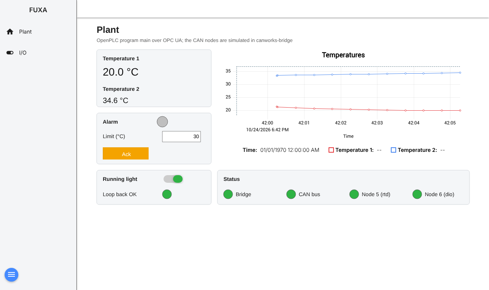

# OpenPLC and FUXA example

An OpenPLC Editor project with a [FUXA](https://github.com/frangoteam/FUXA) web HMI, on the simulated plant of the [Modbus bridge example](../modbus-bridge/canworks.json): a temperature module (node 5) whose first two channels follow a sine (20.0-26.0 °C) and a ramp, and a 16-bit digital I/O module (node 6) whose outputs loop back to its inputs. Both nodes are simulated inside canworks-bridge, so no CAN interface is needed. The Node-RED dashboard example uses the same plant, names and logic.

```
FUXA ──OPC UA──> OpenPLC Runtime v4 (main + PLANT_LOGIC)
                     │ its own Modbus master, 127.0.0.1:1502, PLC link
                     v
                 canworks-bridge ── simulated rtd (node 5) + dio (node 6)
```

The logic runs in the PLC, and FUXA reads and writes the program's variables by name over the runtime's OPC UA server. The PLC reaches the plant the usual way for OpenPLC ([docs/modbus-bridge.md](../../docs/modbus-bridge.md#openplc)).



## Run it with Docker

You need Docker with Compose (Docker Desktop on macOS and Windows; with Colima on a Mac also the `docker-compose` plugin, for example from Homebrew), the [OpenPLC Editor](https://github.com/Autonomy-Logic/openplc-editor) and internet on the first start.

1. In this folder:

   ```sh
   docker compose up
   ```

2. Open this folder in the OpenPLC Editor (**Open Project**). In the device settings type the address `localhost:8443`; the first time, the editor asks you to create the runtime's user. Then **Build and Upload**.
3. Open FUXA at <http://localhost:1881>. The first start takes about half a minute more while FUXA installs its OPC UA driver. Its values appear once the program runs.

`docker compose up` starts:

- **setup**, from the canworks-bridge image: copies the plant's files ([canworks/](canworks/)) for the bridge, then exits.
- **bridge**: canworks-bridge with the simulated plant, serving Modbus TCP on `127.0.0.1:1502` inside the services' network only.
- **runtime**: upstream's OpenPLC Runtime v4.3.1, unchanged, in the bridge's network. It runs the uploaded program, and its OPC UA server runs because the project has one ([devices/servers/opcua.json](devices/servers/opcua.json)).
- **fuxa**: FUXA 1.3.5 in the same network. [fuxa/start.sh](fuxa/start.sh) installs FUXA's OPC UA driver and loads [fuxa/project.json](fuxa/project.json) once, so changes you make in FUXA's editor stay.

Only this PC can reach them (`127.0.0.1`): the runtime on port 8443, FUXA on 1881 and the OPC UA server on 4840, for example for UaExpert at `opc.tcp://localhost:4840/openplc/opcua`. `canworks-local-runtime` uses port 8443 too and the [FUXA with Node-RED example](../fuxa-node-red/README.md) port 1881, so stop one before starting the other (`canworks-local-runtime stop`, or `docker compose down` in the example's folder).

| Setting | How |
| --- | --- |
| canworks version | `CANWORKS_VERSION=0.137.1 docker compose up` (default `latest`). |
| Upload from the command line | `openplc-cli upload . --host localhost --yes` in this folder, with the runtime's user in `OPENPLC_USER` and `OPENPLC_PASSWORD`, once it exists. |
| Stop | `docker compose down`. The program, the runtime's user and your FUXA changes stay in volumes. |
| Start over | `docker compose down -v`, then `docker compose up`: a new runtime (create the user and upload again) and FUXA with this folder's project. |

The project was made with OpenPLC Editor 4.3.2. `limit` and `run` start at 25.0 and on after every PLC start; they are not retained.

## The project

- [pous/function-blocks/plant_logic.st](pous/function-blocks/plant_logic.st): `PLANT_LOGIC`, the plant logic of the other examples.
  - The alarm comes on when temperature 1 is valid (bridge and node 5 OK) and over the limit, and stays on until **Ack** is pressed once that no longer holds. It sets bit 0 of `dio_out0`.
  - While the running light is on, one bit walks along `dio_out1` every 500 ms, and the light counts as OK when `dio_in1` matches what was written. With it off, `dio_out1` follows the I/O view's switches.
- [pous/programs/main.st](pous/programs/main.st): the HMI's variables (`temp1`, `limit`, `alarm`, ...), taken from and written to the `canworks` variable list, and the call of `PLANT_LOGIC`.
- `canworks/canworks.json`: the plant and the OpenPLC connection. Saving it in the configurator writes `devices/remote/canworks.json`, `canworks_in`, `canworks_out` and the `canworks` variable list, which are committed as written.
- [devices/servers/opcua.json](devices/servers/opcua.json): the OPC UA server, which the editor shows under its servers. It publishes `main`'s variables as `PLC.main.<name>` and every value of the `canworks` list as `PLC.canworks.<name>`, read-only except `limit`, `ack`, `run`, `manual_out0` and `manual_out1`, which the anonymous `operator` role may write. Namespace index 2 in FUXA's tags (`ns=2;s=PLC.main.temp1`).

FUXA's two views:

- **Plant**: both temperatures with a trend, the **Limit**, the alarm with **Ack**, the **Running light** switch with its check, and the status of the bridge, the CAN bus and each node.
- **I/O**: the 16 inputs and 16 outputs of node 6 as lamps, with switches for bits 1-7 of `dio_out0` and, while the running light is off, for `dio_out1`. A switched output comes back on its input within a second.

In compose, FUXA's device address is `opc.tcp://bridge:4840/openplc/opcua`: the runtime's OPC UA server listens on the network's own address, not on `127.0.0.1`, and `bridge` is that address.

## Run it without Docker

With canworks-bridge and the OpenPLC Runtime v4 on a Linux device ([docs/modbus-bridge.md](../../docs/modbus-bridge.md#install)):

1. Copy `canworks/canworks.json`, `canworks/simulation.json` and the two EDS files to `/etc/canworks-bridge/plant/` on the device and `sudo systemctl start canworks-bridge@plant`.
2. Upload this project to the device's runtime from the editor.
3. Run FUXA anywhere (Docker, or `npm` as its README says), import `fuxa/project.json` (**Open project** in FUXA's editor) and change the OpenPLC device's address to `opc.tcp://<device>:4840/openplc/opcua`.

## OPC UA security

The server takes anonymous sessions with no encryption, which is fine on a PC where only `127.0.0.1` reaches it. On a real machine, in the editor's OPC UA server settings turn on a Sign or SignAndEncrypt profile with users, turn anonymous access off, and give FUXA's device the same security and user.
