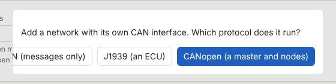
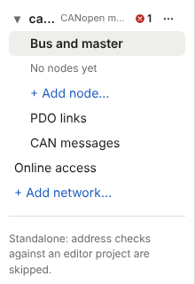
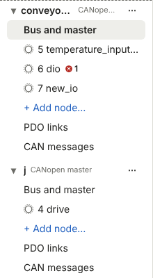

## Why

Text in the Configure workspace is cut off where the user needs to read it:

- **Add network…** asks "Which protocol does it run?" with four buttons in one row: Cancel, Plain CAN (messages only), J1939 (an ECU) and CANopen (a master and nodes). The row is wider than the 520 px dialog and is aligned to the right, so it runs out of the dialog's left edge. Cancel is not visible at all and Plain CAN reads "…N (messages only)". This happens at every window width, not only on small screens: the row is 641 px wide in a 490 px box. Cancel also gets the focus when the dialog opens, so the focused button is one the user cannot see.

  

- **The network tree** puts a network's name, its protocol, its problem badge and its menu button on one 220 px line, and cuts both texts with an ellipsis. A new network named `can0` with one problem reads "ca… CANopen m…": the network cannot be told apart from another one by its name. A 16-character name (the longest allowed) shows 9 characters, and a node named `temperature_inputs_left` reads "5 temperature_input…". The full text is only in a tooltip, which a keyboard or touch user does not get.

   

A scan of the other Configure views (every tree entry, every node tab, Variable declarations, Simulation, Trace, Frame lab, every network menu) at 1101, 1280 and 1600 px found one more cut text: the **Dir** column heading of the Trace identifier table is 3 characters wide and shows "Di". Everything else fits.

The existing requirement "Network tree keyboard" asks for the ellipsis; this change replaces that with whole names.

## What Changes

- **Dialog buttons never leave the dialog.** In every dialog of the configurator the buttons wrap onto a further row when they do not fit on one, and a button label longer than the dialog is wide wraps inside its button. Every button stays inside the dialog's box at any window width. The order of the buttons and the focus rules ("Confirmation dialogs default to the safe choice") do not change.
- **Add network… shows its protocols as a list.** The dialog lists the three protocols one per row, each as a large choice with its name and one line on what it is for, then Cancel:
  - **CANopen**: a master and its nodes from EDS files, or the PLC as a slave device;
  - **J1939**: the PLC as an ECU that sends and receives parameter groups from a DBC file;
  - **Plain CAN**: CAN frames only, from a DBC file or entered by hand, with no protocol on top.

  CANopen comes first and gets the focus, as it is the default protocol today; Escape and Cancel add nothing.
- **The tree shows whole names.** A network entry gets two lines: its name (with the fold arrow, problem badge and menu button) on the first and its protocol, in small muted text, on the second. Names of networks and nodes are never cut: a name wider than the column wraps onto the next line, breaking inside the name when it has no space. The tooltip stays.
- **Trace Dir heading.** The Dir column of the Trace identifier table is wide enough for its heading and the sort mark.
- **A page test for cut text.** A test walks the Configure workspace at 1000, 1280 and 1600 px with a config of long names and fails when a text of the page is cut (ellipsis or hidden overflow on something that is not a data cell with its own tooltip) or when anything of an open dialog is outside the dialog.

No file format, server protocol or CLI change.

Out of scope:
- The Commission workspace, apart from what it gets for free: it uses the same tree and the same dialogs, so it gets the same fixes.
- Cells of data tables that are cut on purpose with the whole value in a tooltip (Trace rows, frame identifiers).
- The width of the tree column: it stays 220 px; wrapping is enough for the longest allowed network name, and node names have no length limit, so a wider column would not remove the need to wrap.

## Capabilities

### New Capabilities
None.

### Modified Capabilities
- `canopen-configurator`: dialog buttons stay inside the dialog; Add network lists its protocols with a line each; the tree shows whole network and node names, with the protocol on its own line (replaces the ellipsis of "Network tree keyboard"); no cut text in Configure.

## Impact

- Configurator page: `tools/deploy/canworks/configurator/static/`
  - `style.css`: `dialog menu` wraps, dialog buttons wrap their label; tree rows wrap and the network entry's two lines; the Trace identifier table's Dir column;
  - `app.js`: `addNetwork()` builds the protocol list in the dialog's extra part instead of four buttons;
  - `tree.js`: the network entry's protocol on its own line.
- Tests: the cut-text page test; Add network tests (choices, focus, Escape); tree tests updated for the two-line network entry.
- Docs: `docs/configurator.md` (Add network…, tree entries). README.md is checked and changed only if it describes the dialog or the tree.
- Version: PC tools patch bump. No plugin change, so no hardware test.
